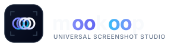

<p align="center">
  
</p>

<p align="center">
  <strong>The open-source interactive canvas studio for App Store & Google Play visuals.</strong><br>
  Concevez, personnalisez et exportez vos captures d'écran et bannières officielles en haute définition.<br>
  👉 <strong><a href="https://mookoop.studio">https://mookoop.studio</a></strong> (Studio en direct : <strong><a href="https://mookoop.studio/studio">mookoop.studio/studio</a></strong>)
</p>

<p align="center">
  <a href="LICENSE.md"></a>
  <a href="https://nextjs.org/"></a>
  <a href="https://www.typescriptlang.org/"></a>
  <a href="https://tailwindcss.com/"></a>
  <a href="CONTRIBUTING.md"></a>
</p>

---

## ✨ Features

- 🌟 **Turnkey Demos Catalog** — 6 ready-to-use production designs: Fintech (*NovaPay*), Health (*PulseAI*), Delivery (*NomNom*), Social (*Sphere*), Fitness (*AuraFit*), and E-commerce (*LuxeShop*). Load any demo in 1 click via the toolbar's **Démos** catalog.
- 🎨 **Play Store Feature Graphic (1024×500) Suite** — Full creative freedom with interactive device drag-and-drop, custom device scaling (0.4× to 1.6×), 3D perspective tilt (−30° to +30°), and dynamic logo/tagline layouts.
- ✍️ **Universal Text Alignment** — Direct caption alignment controls (Left, Center, Right) across all standard phone, tablet, and desktop mockups as well as the Play Store banner, with RTL/LTR compliance.
- ⚡ **Individual & Bulk Export** — Instant 1-click single mockup download (direct PNG button on each slide header) or full platform bundle export as a clean, deduplicated ZIP archive.
- 🖼️ **Connected Canvas Editor** — Screens sit on an interactive horizontal canvas. Move devices, captions, and overlays across screen boundaries with split cropping in Connected mode.
- 🎭 **Style Lab & Scene Playground** — Instantly explore 8 curated aesthetics (Editorial, Swiss Bold, Panorama, Dreamy, Minimal, etc.), or dial in continuous aurora gradients, spotlights, shadows, and device tilt.
- 📱 **Real Bezels & Multi-Platform** — Official Apple product bezels (iPhone 18 Pro Max, iPad Pro M5, Apple Watch Ultra 3, Apple TV 4K, MacBook Air M5, iPhone Duo outer/inner) alongside Android Phone & Tablet frames.
- 🔒 **Zero-Config Local Persistence** — Fully private, offline-first storage: atomic auto-save to `app-store-screenshots.json` (git-trackable) + instant localStorage cache. Zero external database required.

---

## 🚀 Quick Start

Requires **Node.js 20.9+** (or Bun / pnpm / yarn).

```bash
# Clone the repository
git clone https://github.com/Monde123/mookoop.git
cd mookoop

# Install dependencies
npm install    # or bun install / pnpm install

# Start the local development server
npm run dev    # open http://localhost:3000
```

---

## 💡 How It Works

### 1. Demos & Presets
Click **Démos** in the top toolbar to browse the pre-configured packs. Selecting a demo instantly loads crafted color palettes, typography, real captions, and curated layout compositions for the active device.

### 2. Customizing Mockups & Text Alignment
- **Select any screen**: Click on a slide or choose it in the bottom dock.
- **Edit Typography**: In the **Typographie** section of the Inspector, type your headline, choose your font weight and size, and set your alignment to **Left (Gauche)**, **Center (Centre)**, or **Right (Droite)**.
- **Select Active Elements**: Clicking directly on a caption on the canvas activates the alignment toggles right inside the Active Element panel.

### 3. Feature Graphic Suite (1024×500)
Switch to the **Android → Feature Graphic (1024×500)** target:
- **Interactive Drag & Drop**: Drag the mockups directly on the canvas to place them anywhere you want.
- **Scale Control**: Use the **Échelle** slider (40% to 160%) to shrink or enlarge the devices.
- **Position Offsets**: Fine-tune with the **Position X** & **Position Y** sliders.
- **Tilt 3D**: Adjust the 3D perspective angle (−30° to +30°) in the Scene settings.
- **Reset**: Instantly revert to default centered layout with the reset button.

### 4. Exporting Your Work
- **Single Mockup**: Click the **📥 PNG** icon directly on any slide header to download only that screen in ultra-high resolution.
- **Bundle ZIP**: Select your target resolution in the toolbar and click **Export bundle**. The exporter compiles pixel-perfect, opaque 24-bit RGB PNGs (required by Google Play & App Store Connect) with zero duplicates.

---

## 📁 Project Structure

```
mookoop/
├── public/
│   ├── frames/             # Apple & Android hardware bezels
│   ├── icon.svg            # Official app icon
│   ├── logo.svg            # Vector mookoop brand logo
│   └── screenshots/        # Static device screenshots
├── src/
│   ├── app/                # Next.js App Router (pages & API endpoints)
│   ├── components/
│   │   ├── brand/          # MookoopLogo & identity components
│   │   └── editor/         # Canvas, inspector, toolbar, dialogs & frames
│   └── lib/                # Demos, layouts, export engines, types & themes
├── CONTRIBUTING.md         # Guidelines for open-source contributors
├── LICENSE.md              # CC BY-NC 4.0 Legal terms
└── package.json
```

---

## 🛠️ Verification & Tests

To run the automated verification suite:

```bash
# Typecheck
npm run typecheck

# Production build
npm run build

# End-to-end tests (requires Chrome)
npm run test:e2e
```

---

## 🤝 Contributing

Contributions, bug reports, and feature requests are welcome!  
Please read our [Contributing Guide](CONTRIBUTING.md) to get started with our Conventional Commits workflow and code style.

---

## 📜 License

This project is licensed under the **Creative Commons Attribution-NonCommercial 4.0 International (CC BY-NC 4.0)** license.  
See the [LICENSE.md](LICENSE.md) file for details.
